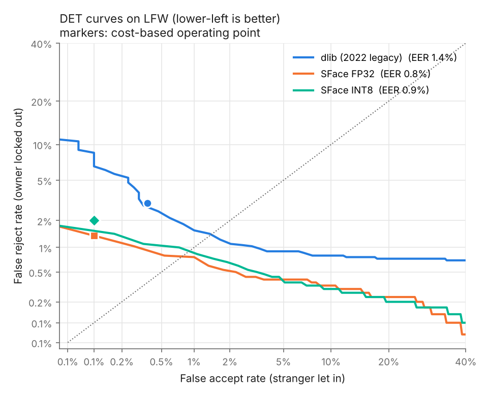

# EdgeAuth

An on-device facial verification and evaluation lab built from a 2022 Raspberry Pi smart lock project. Given a claimed subject ID and a capture, EdgeAuth checks face quality, screens the presentation, and compares an embedding against that subject’s encrypted template. It runs on the local CPU and makes a verification decision for the operator to inspect.

The [2022 archive](legacy/2022/) contains the recovered Tkinter, dlib and GPIO implementation. The current lab uses YuNet for detection, five-point alignment and SFace for embeddings. The evaluation tools compare FP32 and INT8 SFace and measure how much capture quality and threshold choice change results.

## The study: how well does face verification work on a £50 device, and for whom?

The main result of this repository is a benchmarking study on LFW (6,000 pairs, 4,281 people).
It compares the 2022 lock's dlib matcher with SFace FP32 and INT8, using out-of-sample error
rates, cost-based thresholds, bootstrap confidence intervals and subgroup analysis.
**Read the write-up: [reports/findings.md](reports/findings.md).**

| | dlib (2022) | SFace FP32 | SFace INT8 |
| --- | ---: | ---: | ---: |
| Equal error rate | 1.37% | **0.80%** | 0.87% |
| False accepts, cost-based threshold | 0.37% | **0.10%** | 0.10% |
| False accepts, same-ethnicity strangers (worst group) | **9.4%** (Asian) | 0.40% (Black) | 0.35% (Indian) |
| Median latency (x86, 1 thread) | 120 ms | **38 ms** | 44 ms |
| Model size | 31.6 MB | 38.9 MB | **10.1 MB** |



```sh
python -m pip install -e ".[study,legacy,tracking]"  # legacy builds dlib (slow); tracking adds MLflow
edgeauth-study run                                   # fetch LFW, embed, analyse, benchmark, plot
```

Each stage caches its output under `.edgeauth-study/`. Results are written to
`reports/results/` and figures to `reports/figures/`. With MLflow installed, every run is also
logged (`mlflow ui`). See [MODEL_CARD.md](MODEL_CARD.md) for intended use and limitations,
and [pi/](pi/) to reproduce the edge benchmark and run the live door demo on a Raspberry Pi.

## The verification lab

| Capability | Implementation |
| --- | --- |
| 1:1 verification | Three-capture enrolment, normalized template centroid and cosine comparison against one claimed identity |
| Capture screening | Single-face gate, minimum face size, framing, exposure and blur checks |
| Presentation attack detection (PAD) | Passive MobileNetV3 classifier, applied during enrolment and verification with a configurable cutoff |
| Local storage | AES-256-GCM authenticated encryption, keyed subject lookups, template replacement and deletion |
| Verification evaluation | Identity-disjoint calibration and test manifests, FAR, FRR, FMR, FNMR, ROC, DET, AUC and interpolated EER |
| Edge performance | FP32 and INT8 model sizes, single-thread CPU p50/p95 and embedding similarity |
| Results dashboard | Verification, PAD and benchmark JSON reports, with a deterministic synthetic example |

## Run locally

Use Python 3.10 or newer. The commands below work from the repository root once a virtual environment is active.

```sh
python -m venv .venv
# macOS/Linux: source .venv/bin/activate
# Windows PowerShell: .venv\Scripts\Activate.ps1
python -m pip install -e ".[dashboard]"
edgeauth download-models
edgeauth init
```

The first download fetches about 61 MB of model data and verifies each file against a pinned digest. After that, inference runs offline. To install one recognizer, use `edgeauth download-models --variant sface-fp32` or `--variant sface-int8`. The CPU benchmark uses both.

Use three separate JPEG or PNG captures of a consenting participant. The quality gate expects a clear, well-lit, fully visible face.

```sh
edgeauth enrol subject-a data/a-front.jpg data/a-second.jpg data/a-third.jpg
edgeauth verify subject-a data/a-probe.jpg --threshold 0.55
edgeauth delete subject-a
```

`0.55` is an example threshold for experimenting. Use the evaluation workflow to choose a threshold for your inputs. Verification returns JSON containing the decision and uses exit status 0 for acceptance, 1 for rejection and 2 for an operational error. Use `--replace` for intentional re-enrolment. After switching recognition variants, re-enrol subjects with the selected variant.

The vault never stores captures. The database and generated key default to `.edgeauth/`. Use global `--key-file` before the subcommand to keep the key outside the database directory. Keep it under the operator's OS account, back it up separately, and protect access to both locations. Removing a template affects the current vault. The operator manages copies, backups and source captures separately.

## Evaluate on consented data

Build the following CSV manifest with real paths relative to the CSV. Each identity uses one three-image reference gallery. Include genuine and impostor comparisons in both splits, and keep identity aliases, enrolment images and probe images disjoint as appropriate. Use different capture sessions for enrolment and probes.

```csv
split,reference_id,probe_id,reference_a,reference_b,reference_c,probe
calibration,cal-a,cal-a,cal/a1.jpg,cal/a2.jpg,cal/a3.jpg,cal/a4.jpg
calibration,cal-a,cal-b,cal/a1.jpg,cal/a2.jpg,cal/a3.jpg,cal/b4.jpg
test,test-a,test-a,test/a1.jpg,test/a2.jpg,test/a3.jpg,test/a4.jpg
test,test-a,test-b,test/a1.jpg,test/a2.jpg,test/a3.jpg,test/b4.jpg
```

```sh
edgeauth evaluate data/pairs.csv --target-fmr 0.01 --robustness --output reports/fp32.json --policy-out reports/fp32-policy.json
edgeauth evaluate data/pairs.csv --variant sface-int8 --target-fmr 0.01 --robustness --output reports/int8.json
edgeauth verify subject-a data/a-probe.jpg --policy reports/fp32-policy.json
edgeauth benchmark data/a-probe.jpg --output reports/latency.json
```

- Calibration selects the lowest observed threshold that meets the empirical FMR target and accepts at least one genuine calibration trial. Test scores never select the threshold. A policy binds the threshold to the exact detector, recognizer, PAD model and PAD cutoff.
- FMR and FNMR use scored trials. FAR and FRR use all attempts, with rejected captures and failed galleries counting as denials. The report shows score coverage and counts alongside the rates.
- Robustness applies reduced brightness, Gaussian blur, and 4× spatial downsampling to the held-out probe only, using the same calibration threshold throughout. These transforms measure image degradation. Pose and real capture variation require deliberately collected test data.
- Report the number of distinct participants and sessions, and treat repeated trials from the same participant as dependent. An empirical FMR of 0 with a small number of impostor trials gives limited evidence about real-world false matches. The smallest nonzero observed FMR is one divided by the number of scored impostor trials.
- Benchmarking times detection, alignment, embedding and PAD after warm-up, excluding model startup, image decoding, storage and I/O. FP32/INT8 embedding similarity for one image measures numerical drift. Verify accuracy separately on the paired manifest and re-run latency on the target device.

For PAD evaluation, use a separate CSV with columns `capture,label,species`. Use `bona-fide` and `attack` as labels and provide a grouping such as `direct`, `print` or `display`. Keep samples used for cutoff development separate from this evaluation set. The classifier error rate is APCER for attack captures and BPCER for bona fide captures. The pipeline error rate also accounts for capture-quality rejections.

```sh
edgeauth evaluate-pad data/presentations.csv --output reports/pad.json
python -m streamlit run dashboard/app.py --server.address 127.0.0.1
```

The dashboard opens with synthetic example scores. Load an evaluation, PAD or latency JSON report from the sidebar. Keep source images, manifests, templates, keys and local reports out of Git.

## Security model and validation status

The lab is for a trusted local operator evaluating an untrusted capture. A still-image PAD classifier can screen some presentations. Its output cannot establish trusted sensor capture or stop arbitrary camera-stream injection. The project does not connect to a lock or expose a remote verification endpoint. Physical entry or account authentication would require a trusted capture path, a possession factor such as a passkey, retry controls, a fallback and independent PAD and accuracy testing. See [NIST SP 800-63B-4](https://pages.nist.gov/800-63-4/sp800-63b.html#biometrics) for the standard behind those deployment requirements.

Accuracy, demographic performance and latency are measured in the [LFW study](reports/findings.md). PAD coverage and Raspberry Pi latency still need a labelled attack dataset and the target hardware.

## Model provenance

Model files are fetched from project-owned sources and are excluded from this repository's license and history. See each source for model terms and training-data details.

- [YuNet, OpenCV Zoo](https://github.com/opencv/opencv_zoo/tree/main/models/face_detection_yunet) lists MIT terms.
- [SFace, OpenCV Zoo](https://github.com/opencv/opencv_zoo/tree/main/models/face_recognition_sface) lists Apache 2.0 terms.
- [Anti-Spoof MN3, Open Model Zoo](https://github.com/openvinotoolkit/open_model_zoo/tree/master/models/public/anti-spoof-mn3) lists MIT terms for the original model.
- [dlib face recognition model](https://github.com/ageitgey/face_recognition_models), used only as the 2022 baseline, is CC0.
- [LFW](https://vis-www.cs.umass.edu/lfw/) and its [attribute labels](https://www.cs.columbia.edu/CAVE/databases/pubfig/download/lfw_attributes.txt) are downloaded at run time for research use and are never committed.

```sh
python -m pip install -e ".[dev,dashboard]"
ruff check src dashboard tests pi
ruff format --check src dashboard tests pi
pytest -q
```
