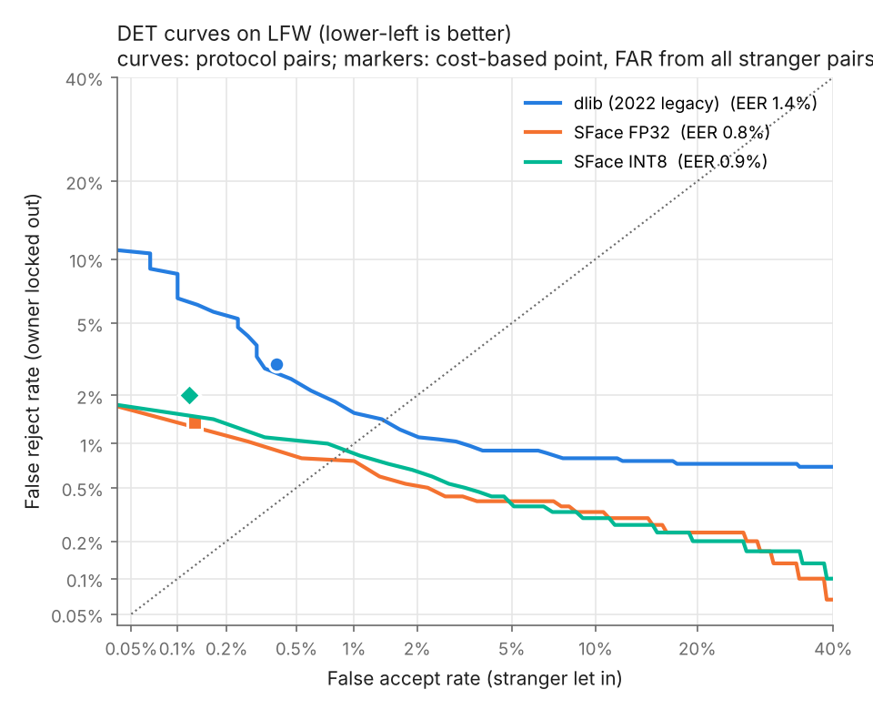
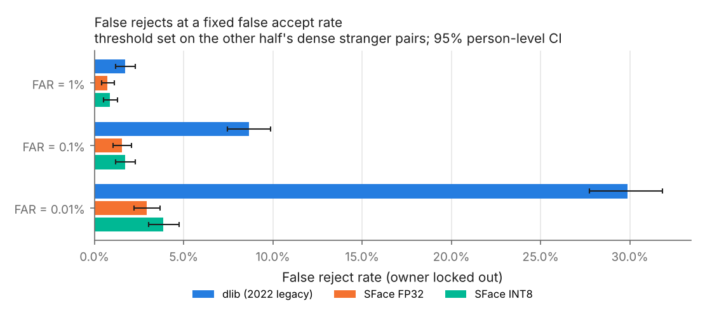
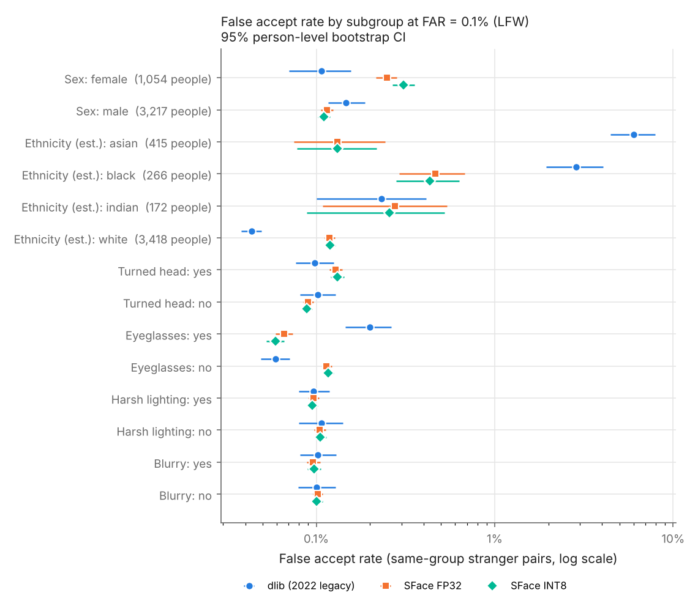
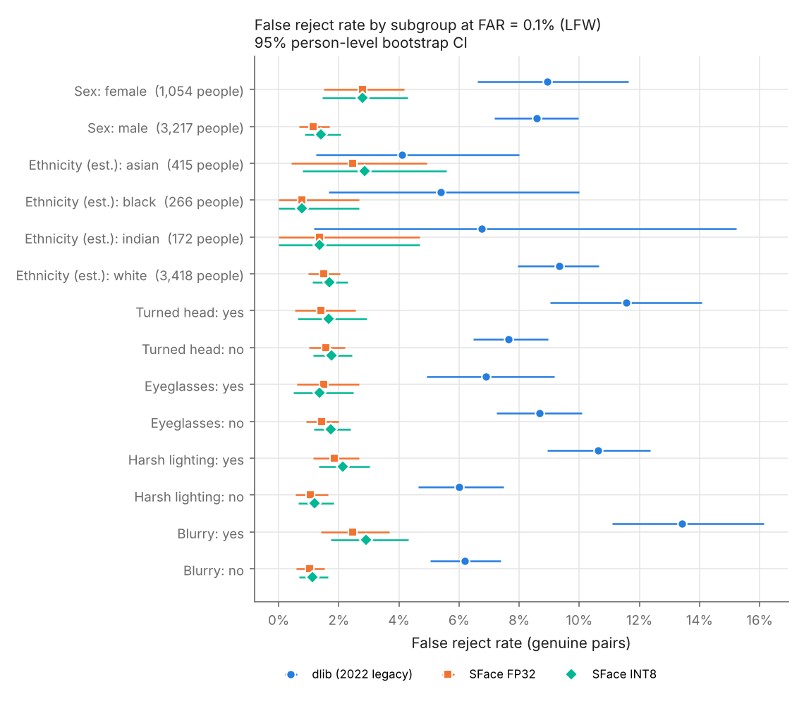
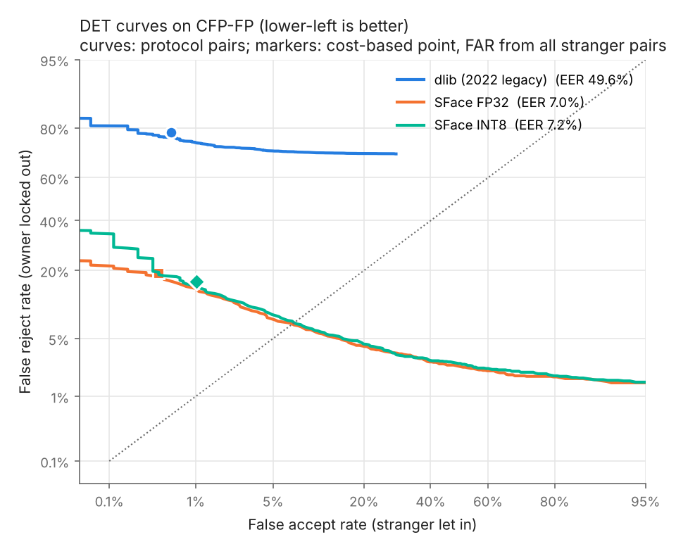
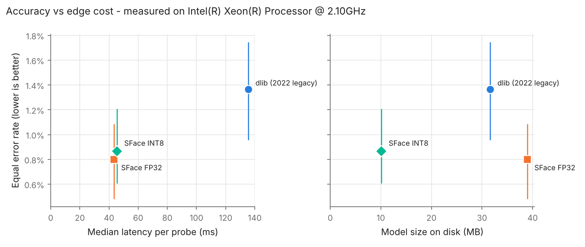

# Who gets locked out, and who gets let in? Evaluating face verification for a £50 smart lock

*EdgeAuth study, November 2026. Every number below is regenerated by `edgeauth-study`; the full
tables, with confidence intervals, are in [`tables.md`](tables.md), and raw results in
[`results/`](results/).*

## Abstract

A 2022 Raspberry Pi smart lock opened for any detected face. We fixed the bug and then asked the
question it hid: once the lock compares against enrolled templates, how often does it let a
stranger in, how often does it lock the owner out, and does that depend on who you are? We
compare the lock's original matcher (dlib ResNet, via `face_recognition`) with a modern edge
model (SFace, FP32 and INT8) on four public benchmarks: LFW, CFP frontal-frontal, CFP
frontal-profile and CelebA. That covers 5,781 distinct people and 22,396 verification pairs. Thresholds
are calibrated on one identity-disjoint half and tested on the other. False accept rates are
measured on dense sets of 1.9-7.6 million stranger pairs per half, so FAR targets down to 0.01% can be
resolved. Uncertainty comes from a person-level bootstrap.

At a fixed 0.1% false accept rate, the legacy model locks the owner out **8.7%** of the time on
LFW, against **1.5%** for SFace. More seriously, the same global threshold lets in **6.0%** of
same-ethnicity Asian strangers and **2.9%** of Black strangers, against **0.04%** for White
strangers: a 67-140× disparity. SFace reduces the worst ethnicity disparity to about 4× and
the sex disparity to about 2×. Both remaining gaps replicate on CelebA. Neither model copes
with 90° profiles, and INT8 quantisation saves 74% of model size but no latency on x86, at a
small accuracy cost on hard captures.

## 1. Introduction

Face verification on a door is a 1:1 decision: does this capture match the claimed resident?
It can fail in two ways, with very different costs. A **false accept** lets a stranger in. A
**false reject** makes the owner try again. A single summary number such as accuracy, or the
equal error rate (EER), hides both the trade-off and *who* bears each kind of error.

The 2022 version of this lock had a worse problem. It opened whenever *any* face was detected,
so its real false accept rate was 100%. This study starts from that fix and measures what a
correct implementation actually delivers on a £50 device. It covers three dimensions:
accuracy at a security level that suits a door, fairness across demographic groups and capture
conditions, and cost on edge hardware.

## 2. Related work

* **Demographic differentials.** NIST's FRVT Part 3 (Grother et al., 2019, NISTIR 8280) found
  false match rates for many algorithms that varied by factors of 10-100 across demographic
  groups, highest for West/East African and East Asian faces, and higher for women. It
  recommends reporting FMR at a *fixed threshold* per group, as done here.
* **Balanced benchmarks.** RFW (Wang et al., 2019) and BFW (Robinson et al., 2020) were built to
  measure these gaps. They need access requests; loaders are included (§7) for when access is
  granted.
* **Models.** dlib's ResNet face embedding (King, 2009; model released 2017) reports 99.38% on LFW and is the
  backbone of the popular `face_recognition` library used by the 2022 lock. SFace (Zhong et
  al., 2021) is a sigmoid-constrained hypersphere-loss model distributed in OpenCV's model zoo
  with an INT8 variant for edge devices.
* **Statistics.** Pairs that share a person are not independent. We use the two-way
  "pigeonhole" bootstrap (Owen, 2007), which resamples people, not pairs.

## 3. Methods

### 3.1 Data

| Dataset | People | Pairs (genuine) | What it tests | Labels |
|---|---|---|---|---|
| **LFW** View 2 | 4,281 | 6,000 (3,000) | primary benchmark, demographics, conditions | Kumar et al. (2009) attribute *classifiers*: estimated sex, ethnicity, glasses, lighting, blur |
| **CFP-FF** | 500 | 5,272 (3,500) | frontal baseline for the pose comparison | none |
| **CFP-FP** | 500 | 5,258 (3,500) | frontal vs 90° profile | profile flag |
| **CelebA** test split | 1,000 | 5,866 (2,933) | replication of sex and condition effects | annotated sex, eyeglasses, blur, age |

CelebA uses its official *test* identities, which do not appear in its training split. It has
no pair protocol, so each person contributes up to three genuine pairs, with an equal number
of impostor pairs drawn within the same half. CFP's splits are not documented as
identity-disjoint, so people are hashed to halves and impostor pairs that straddle them are
dropped. Every manifest is checked for identity leakage before analysis.

### 3.2 Models

| Model | Detector | Embedding | Score |
|---|---|---|---|
| **dlib (2022)** | HOG, 1× upsampling (library default) | dlib ResNet, 128-d | −Euclidean distance |
| **SFace FP32** | YuNet (2023) + 5-point alignment | SFace, 128-d | cosine |
| **SFace INT8** | as above | SFace, 8-bit weights | cosine |

The dlib pipeline is the 2022 code path with its defaults unchanged. When an image contains
several faces, the one nearest the centre is taken.

### 3.3 Protocol and metrics

* **Out-of-sample everything.** Each dataset is split into two identity-disjoint halves. A
  threshold chosen on one half is applied to the other, and vice versa.
* **Attempt-level rates.** If the detector misses a face (failure to acquire, FTA), that
  attempt is a rejection, not a dropped sample. *FRR* is the share of genuine attempts
  rejected; *FAR* is the share of stranger attempts accepted.
* **Dense stranger sets.** The official 3,000 impostor pairs can't measure a 0.1% FAR (that's
  three events). Instead, *every* cross-person image pair within a half is scored: 7.3-7.6
  million per half on LFW. That resolves thresholds at **FAR = 1%, 0.1% and 0.01%**, and gives
  demographic FAR over *all* same-group strangers, not a sample.
* **Threshold policies.**
  * *Fixed FAR* (the primary policy, as for a security product).
  * *Cost-based*: minimise 10·FAR + 1·FRR, treating a stranger let in as ten times worse than
    an owner retrying.
  * *EER point*.
  * For dlib, also the *2022 default* (distance 0.6).
* **Uncertainty.** 95% percentile intervals from a person-level bootstrap (1,000 resamples).
  For dense FAR, accepted pairs are aggregated to a sparse person×person matrix *A*, and the
  resampled rate is cᵀAc / cᵀNc, with N in closed form. This makes resampling 7 million pairs
  cheap.
* **Subgroups.** FRR uses genuine pairs. FAR uses stranger pairs in which *both* people belong
  to the group (sex, ethnicity) or *either* image has the condition (glasses, blur, lighting,
  turned head). Head pose is estimated from YuNet landmarks.

## 4. Results

### 4.1 Overall accuracy



| LFW | EER | FRR @ FAR 1% | FRR @ FAR 0.1% | FRR @ FAR 0.01% |
|---|---|---|---|---|
| dlib (2022) | 1.37% (0.96–1.75) | 1.73% (1.21–2.31) | **8.67%** (7.46–9.86) | **29.87%** (27.74–31.82) |
| SFace FP32 | **0.80%** (0.48–1.08) | **0.73%** (0.42–1.10) | **1.53%** (1.06–2.06) | **2.93%** (2.23–3.70) |
| SFace INT8 | 0.87% (0.61–1.21) | 0.87% (0.51–1.29) | 1.73% (1.19–2.31) | 3.87% (3.04–4.75) |



The EER understates the gap. At a FAR loose enough for a phone (1%), the models are close.
At security levels suitable for a door, dlib deteriorates much faster: at FAR 0.01% it rejects
the owner about **one attempt in three**, against one in thirty-four for SFace. The thresholds
calibrated on one half reproduced their target FAR on the other half almost exactly (1.001%,
0.101% and 0.010% for dlib), which validates the dense-set calibration.

### 4.2 Choosing the threshold


The cost-based policy puts SFace at a FAR of 0.13% and an FRR of 1.37%, close to the fixed-0.1%
point. The 2022 dlib default (distance 0.6) gives a FAR of 0.53% and an FRR of 2.53%, which
sits between dlib's 1% and 0.1% fixed-FAR points. The full set of operating points is in
[`tables.md`](tables.md).

### 4.3 Demographic differentials



**False accepts against same-group strangers, at a global FAR of 0.1% (LFW):**

| Group | People | dlib (2022) | SFace FP32 | SFace INT8 |
|---|---|---|---|---|
| Asian | 415 | **6.02%** (4.44–7.92) | 0.13% (0.08–0.24) | 0.13% (0.08–0.22) |
| Black | 266 | **2.86%** (1.94–4.06) | 0.46% (0.29–0.68) | 0.43% (0.28–0.63) |
| Indian | 172 | 0.23% (0.10–0.41) | 0.28% (0.11–0.54) | 0.26% (0.09–0.53) |
| White | 3,418 | 0.04% (0.04–0.05) | 0.12% (0.11–0.13) | 0.12% (0.11–0.13) |
| Female | 1,054 | 0.11% (0.07–0.16) | **0.25%** (0.22–0.28) | **0.31%** (0.27–0.36) |
| Male | 3,217 | 0.15% (0.12–0.19) | 0.11% (0.11–0.13) | 0.11% (0.10–0.12) |

This is the study's main finding. With one threshold for everyone, the legacy model's false
accepts are concentrated on Asian (140× the White rate) and Black (67×) households. A threshold
set to let in one stranger in a thousand on average lets in about **one Asian stranger in
seventeen**. The average hides this because LFW is 80% White: dlib is actually *stricter* than
SFace on White strangers. SFace shrinks the worst ethnicity ratio to 3.9× (Black/White) and
puts every group within 0.5%.

The **sex differential** points the other way. dlib shows no excess for women, while SFace falsely accepts
same-sex strangers about **2.2× more often for women**, with non-overlapping intervals. It also
**rejects women about 2.5× more often** (FRR 2.79% vs 1.14%):



**Replication.** The SFace sex gap appears on CelebA, which uses *annotated* sex labels rather
than classifier estimates: FRR 13.0% vs 6.8% (1.9×) and FAR 0.19% vs 0.11% (1.8×), both with
non-overlapping intervals ([`tables.md`](tables.md#celeba)). dlib again shows no sex gap (1.1× FRR, 1.0× FAR). The
ethnicity finding can't be replicated without RFW or BFW (§6).

### 4.4 Capture conditions and pose

* **Blur** roughly doubles false rejects for every model on both LFW and CelebA. SFace on
  CelebA goes from 8.8% to 23.8%, and dlib on LFW from 6.2% to 13.4% at FAR 0.1%.
* **Harsh lighting** raises FRR (SFace on LFW: 1.06% → 1.85%). Eyeglasses barely matter for
  SFace on LFW but raise its FRR by about 40% on CelebA.
* **Profile faces** are the hard limit:

| FRR @ FAR 0.1% | Frontal (CFP-FF) | Profile (CFP-FP) |
|---|---|---|
| dlib (2022) | 7.74% | **86.46%** (detector misses 25% of faces) |
| SFace FP32 | 2.06% | **26.80%** |
| SFace INT8 | 2.74% | 31.06% |



The 2022 detector can't find most profile faces, so dlib performs at chance on CFP-FP (EER
49.6%). SFace still works, but a door camera should be mounted to see residents roughly
head-on.

### 4.5 Edge cost



| x86 (1 thread) | p50 latency | p95 | Throughput | Model size | Peak RSS | Sustained drift (60 s) |
|---|---|---|---|---|---|---|
| dlib (2022) | 136 ms | 318 ms | 6.2 /s | 31.6 MB | 182 MB | −1.2% |
| SFace FP32 | **43 ms** | 51 ms | **22.6 /s** | 38.9 MB | 179 MB | −2.4% |
| SFace INT8 | 46 ms | 54 ms | 21.5 /s | **10.1 MB** | 179 MB | −0.8% |

*Decode, detect, align and embed per probe; 200 LFW probes after 10 warm-up runs, then 60 s of
continuous load per model; Intel Xeon @ 2.1 GHz development container.*

> **Raspberry Pi results pending.** This container isn't a Pi and has no temperature sensor.
> `bash pi/run_benchmark.sh pi5` measures latency, memory, board power, SoC temperature and
> throttling under a 5-minute sustained load on the device (see [`pi/README.md`](../pi/README.md)).
> Its results slot into this section and `figures/tradeoff_pi5.png` / `thermal_pi5.png`.

On x86, SFace is 3× faster than the legacy model and more accurate, so upgrading costs
nothing. INT8 cuts model size by 74% but isn't faster on this CPU. It costs 0.2-1 points of FRR
at strict FARs, and about 4 points on profiles. Whether ARM's integer kernels change that is the
open question for the Pi run.

### 4.6 How much does person-level resampling matter?

Person-level intervals for FRR are **1.12-1.27× wider** than pair-level ones on LFW
([`tables.md`](tables.md#person-level-vs-pair-level-intervals)). The effect is largest for
minority groups, where a few people contribute many pairs. Pair-level intervals would have
overstated the precision of exactly the comparisons that matter most.

## 5. Discussion and deployment recommendation

1. **Use SFace, calibrated at a fixed FAR (0.1%) or with the 10:1 cost policy.** It dominates
   the 2022 model on every dataset and costs less to run.
2. **Don't trust a single global threshold to be fair.** The legacy model's 0.1% average FAR
   concealed a 6% FAR for Asian strangers. For any deployment, report FAR by group at the
   chosen threshold, as NIST FRVT does.
3. **Expect a residual sex gap.** SFace rejects women about twice as often and accepts female
   strangers about twice as often, on two datasets with two kinds of labels. A household
   deployment should test this on its own enrolment captures.
4. **Mount the camera for frontal capture** and reject blurred frames (the lab's quality gate
   already does). Pose and blur cause more errors than any model choice.
5. **Pick FP32 unless storage forces INT8**, pending the Pi benchmark.

## 6. Limitations

* **No balanced ethnicity benchmark yet.** The ethnicity result rests on LFW alone, with
  *estimated* labels from 2009-era attribute classifiers and a coarse four-way split. RFW and
  BFW loaders are written but untested until access is granted.
* **Web photos, not a doorway.** All four datasets are photos of public figures. Relative
  findings (rankings, the direction of gaps, the effect of conditions) should transfer better
  than absolute rates.
* **Group sizes.** The Indian group has 172 people on LFW, so its intervals are wide.
* **1:1 only.** The 2022 lock did 1:N identification. Its false match rate grows roughly with
  the number of enrolled residents.
* **No spoofing.** Presentation attacks are out of scope here. The lab's PAD screen needs a
  labelled attack dataset to evaluate (`edgeauth evaluate-pad`).
* **Hardware.** Edge numbers are from an x86 container until the Pi run lands.

## 7. Reproducibility

```bash
pip install -e '.[study,legacy,tracking]'
edgeauth-study run                          # LFW: prepare, embed, analyse, benchmark, figures, tables
edgeauth-study --dataset cfp-ff run         # also cfp-fp, celeba (downloaded and checksummed)
edgeauth-study --dataset rfw --source /path/to/RFW/test run    # once access is granted
edgeauth-study report                       # regenerate tables.md
```

Downloads are pinned by SHA-256 (CFP's host serves only HTTP) or by dataset revision (CelebA).
Every stage caches to `.edgeauth-study/`. Seeds are fixed (2022). MLflow logs one run per
dataset and model when installed. No face images are committed; figures show aggregates only.

## References

* Grother, P., Ngan, M., Hanaoka, K. (2019). *Face Recognition Vendor Test Part 3: Demographic Effects.* NISTIR 8280.
* Huang, G. et al. (2007). *Labeled Faces in the Wild.* UMass Amherst TR 07-49.
* King, D. (2009). *Dlib-ml: A Machine Learning Toolkit.* JMLR 10.
* Kumar, N. et al. (2009). *Attribute and Simile Classifiers for Face Verification.* ICCV.
* Liu, Z. et al. (2015). *Deep Learning Face Attributes in the Wild.* ICCV (CelebA).
* Owen, A. (2007). *The Pigeonhole Bootstrap.* Annals of Applied Statistics 1(2).
* Robinson, J. et al. (2020). *Face Recognition: Too Bias, or Not Too Bias?* CVPR Workshops (BFW).
* Sengupta, S. et al. (2016). *Frontal to Profile Face Verification in the Wild.* WACV (CFP).
* Wang, M. et al. (2019). *Racial Faces in-the-Wild.* ICCV (RFW).
* Zhong, Y. et al. (2021). *SFace: Sigmoid-Constrained Hypersphere Loss for Robust Face Recognition.* IEEE TIP.

## Appendix: CV bullets

* **EdgeAuth: face verification fairness and edge benchmarking.** Evaluated the 2022 dlib
  matcher against SFace FP32/INT8 on four public benchmarks (5,781 people, 22,396 pairs) with
  identity-disjoint cross-calibration, dense stranger sets (7M+ pairs) and person-level
  bootstrap intervals.
* Showed that at a fixed 0.1% false accept rate, the legacy model accepted 6.0% of
  same-ethnicity Asian strangers against 0.04% of White strangers (140×). The modern model cut
  owner lock-outs from 8.7% to 1.5% and the worst disparity to 4×, with a sex gap replicated on
  CelebA.
* Built a reproducible pipeline (one command per dataset, checksummed downloads, MLflow
  tracking, model card), plus a Raspberry Pi benchmark for latency, memory, power and thermal
  throttling under sustained load.
