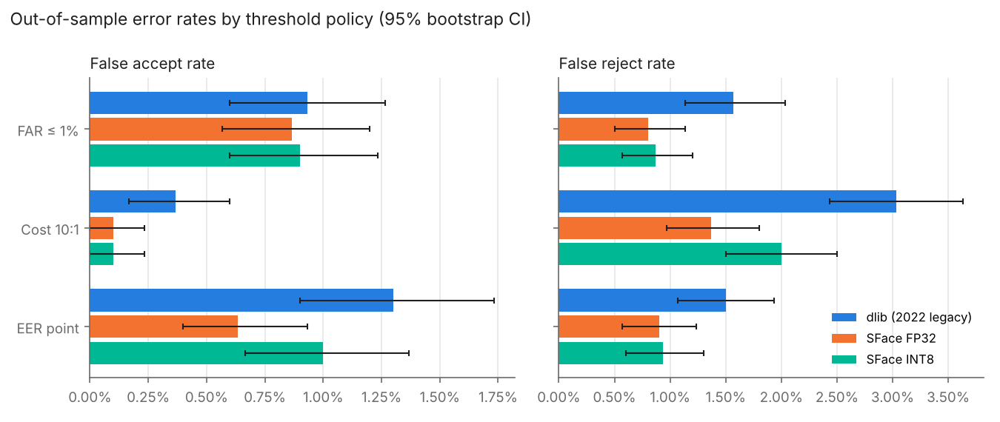
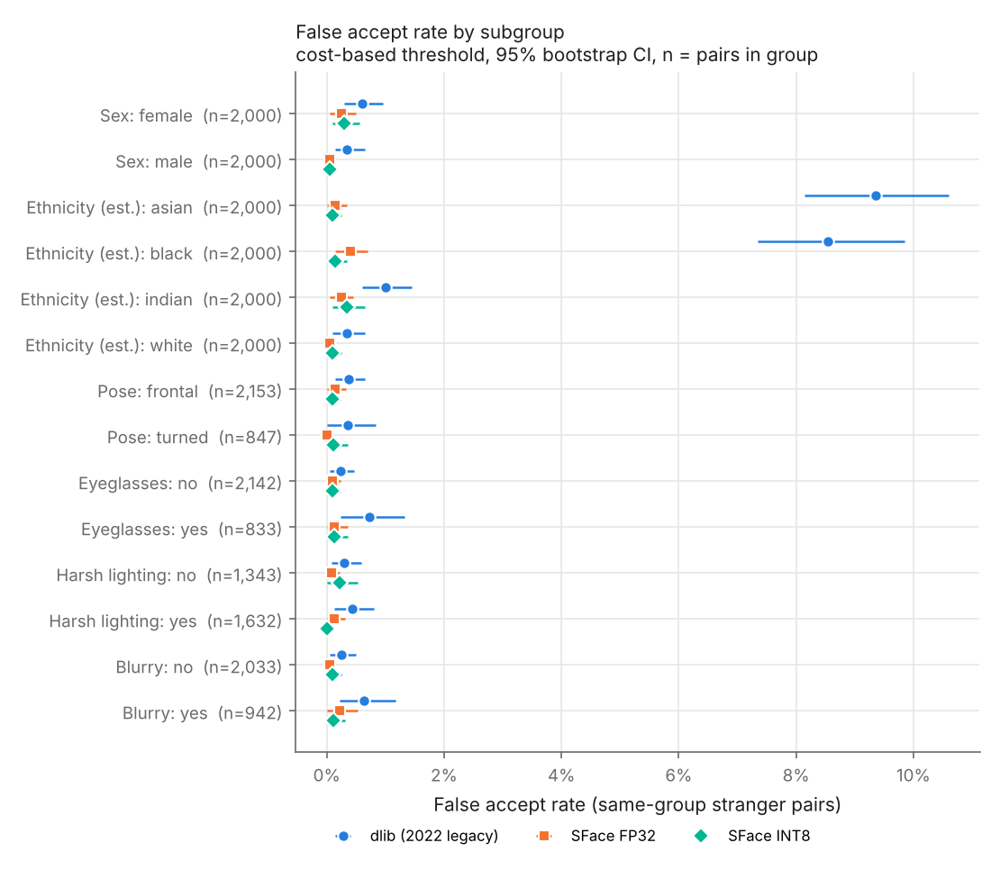
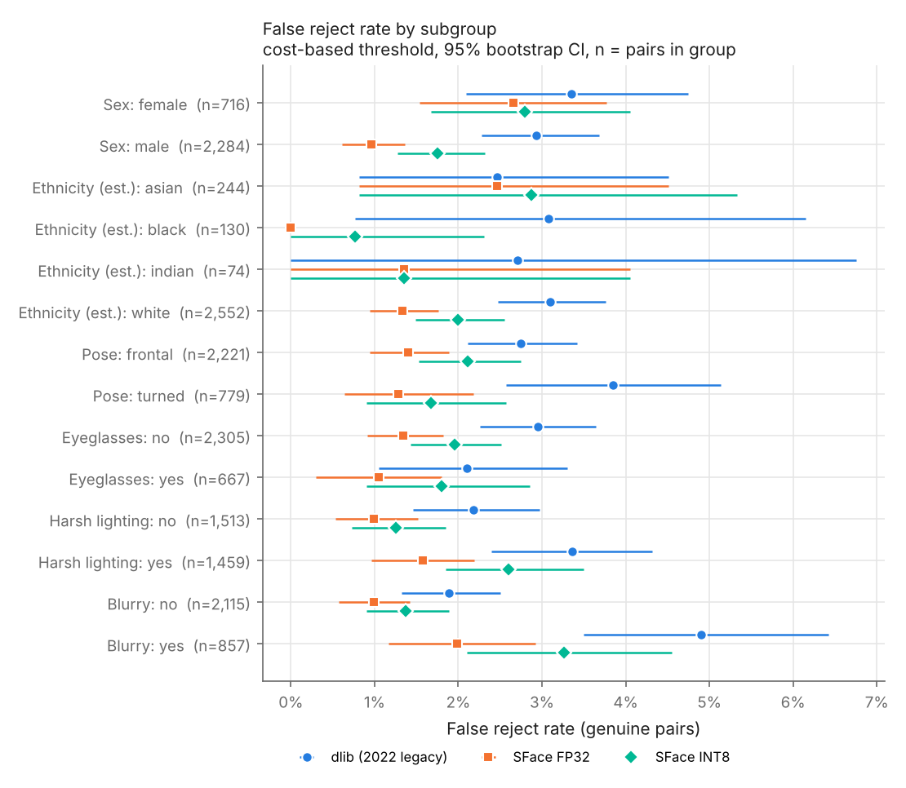

# How well does face verification work on a £50 device, and for whom?

*EdgeAuth study, November 2026. Everything here is regenerated by `edgeauth-study run`;
raw numbers are in [`results/lfw_verification.json`](results/lfw_verification.json).*

## TL;DR

1. **The 2022 lock's matcher was much less fair than its headline accuracy suggests.** On the
   standard benchmark the legacy dlib model has a respectable 1.4% equal error rate. But
   against strangers *of the same ethnicity*, the realistic threat for a front door, it
   falsely accepted **9.4% of Asian and 8.6% of Black impostor attempts, against 0.35% for
   White attempts: about 25× worse.** Roughly one same-ethnicity stranger in eleven would
   have been let in.
2. **A modern embedding (SFace) removes most of that gap and halves the error rate.** EER
   falls to 0.8%, and same-ethnicity false accepts are at most 0.4% in every group. A
   residual gap remains (Black 0.40% vs White 0.05%; women 0.25% vs men 0.05%).
3. **Choosing the threshold by cost matters as much as choosing the model.** Weighting a
   false accept as 10× worse than a false reject cuts SFace's false accepts from 0.9% to
   0.1%, at the price of the owner being rejected 1.4% of the time instead of 0.8%.
4. **INT8 quantisation is a size win, not automatically a speed win.** INT8 SFace is 74%
   smaller with no significant loss in EER, but on the x86 CPU it was 17% *slower*, and it
   degrades more on blurred and harshly lit faces. Whether it is faster on an ARM Pi is the
   open question (see [Edge cost](#4-edge-cost)).

## Motivation

The original 2022 smart lock opened the door if *any* face was detected, known or not, so
its real false accept rate was 100%. Fixing that bug raises the real question: once the
system compares against enrolled templates, how often does it let the wrong person in, how
often does it lock the owner out, and does that depend on who you are?

## Method

| | |
|---|---|
| Data | LFW, official 10-fold View 2 protocol: 6,000 pairs (3,000 genuine, 3,000 impostor), 4,281 people |
| Models | **dlib-legacy**: the 2022 pipeline unchanged (`face_recognition` HOG detector + dlib ResNet 128-d, Euclidean). **SFace FP32 / INT8**: YuNet detector, 5-point alignment, SFace 128-d, cosine |
| Calibration | Two-fold cross-calibration: thresholds chosen on folds 1-5 are tested on folds 6-10 and vice versa. LFW folds are identity-disjoint, so **no reported number is in-sample** |
| Error rates | Attempt-level FAR (stranger accepted) and FRR (genuine user rejected). A face the detector misses counts as a rejection, not a dropped sample |
| Threshold policies | EER point; FAR ≤ 1%; **cost-based**: minimise 10·FAR + 1·FRR |
| Uncertainty | 95% percentile bootstrap intervals (2,000 resamples for rates, 500 for EER/AUC) |
| Subgroups | Sex and ethnicity from the Kumar et al. LFW attribute classifiers (estimated, *not* self-identified); glasses, harsh lighting and blur from the same source; pose from detector landmarks |
| Matched impostors | LFW's official impostor pairs are random, so same-ethnicity strangers are rare (23 Asian, 11 Black, 5 Indian pairs). We added 2,000 same-group stranger pairs per group, sampled within each identity-disjoint half and scored with the other half's threshold |

## 1. Overall accuracy


| Model | EER (95% CI) | ROC AUC | Failure to acquire |
|---|---|---|---|
| dlib (2022 legacy) | 1.37% (1.08–1.68) | 0.984 | 0.45% |
| SFace FP32 | **0.80%** (0.51–1.07) | 0.999 | 0.00% |
| SFace INT8 | 0.87% (0.63–1.18) | 0.999 | 0.00% |

SFace beats dlib over the whole operating range. dlib's curve also flattens at a false
reject rate of about 0.7%: those are faces its HOG detector never finds, so no threshold
can recover them. The FP32 and INT8 confidence intervals overlap almost completely.

## 2. Picking the threshold



| Model | Policy | FAR | FRR |
|---|---|---|---|
| dlib | library default (distance 0.6), as shipped in 2022 | 0.43% (0.20–0.70) | 2.53% (2.00–3.10) |
| dlib | cost 10:1 | 0.37% (0.17–0.60) | 3.03% (2.43–3.63) |
| SFace FP32 | FAR ≤ 1% | 0.87% (0.57–1.20) | 0.80% (0.50–1.13) |
| SFace FP32 | **cost 10:1** | **0.10%** (0.00–0.23) | 1.37% (0.97–1.80) |
| SFace INT8 | cost 10:1 | 0.10% (0.00–0.23) | 2.00% (1.50–2.50) |

For a door, the cost-based SFace policy is the right choice: false accepts drop almost
nine-fold relative to the FAR ≤ 1% policy, and the price is about one extra retry per 170
attempts. The 2022 default of 0.6 turns out to be close to the cost-optimal dlib
threshold, so the legacy system's problem was the any-face bug and the model, not the
tolerance.

## 3. For whom does it fail?

### False accepts against same-group strangers



| Same-group strangers | dlib (2022) | SFace FP32 | SFace INT8 |
|---|---|---|---|
| Asian | **9.35%** (8.15–10.60) | 0.15% (0.00–0.35) | 0.10% (0.00–0.25) |
| Black | **8.55%** (7.35–9.85) | 0.40% (0.15–0.70) | 0.15% (0.00–0.35) |
| Indian | 1.00% (0.60–1.45) | 0.25% (0.05–0.45) | 0.35% (0.10–0.65) |
| White | 0.35% (0.10–0.65) | 0.05% (0.00–0.15) | 0.10% (0.00–0.25) |
| Female | 0.60% (0.30–0.95) | 0.25% (0.05–0.50) | 0.30% (0.10–0.55) |
| Male | 0.35% (0.15–0.65) | 0.05% (0.00–0.15) | 0.05% (0.00–0.15) |

*2,000 pairs per cell, drawn from 266 Black, 414 Asian, 172 Indian, 3,418 White, 1,054
female and 3,217 male people.*

This is the study's main result. dlib's single global threshold is calibrated on a
population that is about 80% White. Embeddings of Asian and Black faces sit closer
together in its feature space, so the same threshold lets far more same-ethnicity strangers
through. This is the demographic false-match differential that NIST FRVT (NISTIR 8280) has
documented for older algorithms. SFace narrows it by an order of magnitude, but the
Black/White and female/male gaps are still visible with non-overlapping intervals.

### False rejects of genuine users



* **Sex:** SFace FP32 rejects women 2.65% (1.54–3.77) of the time against 0.96% (0.61–1.36)
  for men. That is the clearest FRR differential, and the intervals do not overlap.
* **Ethnicity:** minority-group FRR intervals are wide (130 Black, 74 Indian genuine pairs),
  so no ethnicity differential in false rejects can be claimed or ruled out from LFW.
* **Capture conditions:** blur roughly doubles false rejects for every model (dlib 1.9% →
  4.9%). INT8 suffers more than FP32 on blur (3.3% vs 2.0%) and harsh lighting (2.6% vs
  1.6%), so quantisation costs most on hard captures. Turned heads hurt dlib (3.9% vs
  2.8%) but not SFace, thanks to its landmark alignment.

## 4. Edge cost


| Model | Median latency | p95 | Throughput | Model size | Peak RSS |
|---|---|---|---|---|---|
| dlib (2022 legacy) | 120 ms | 141 ms | 8.3 fps | 31.6 MB | 214 MB |
| SFace FP32 | **38 ms** | 47 ms | 25.8 fps | 38.9 MB | 202 MB |
| SFace INT8 | 44 ms | 55 ms | 23.1 fps | **10.1 MB** | 202 MB |

*Single thread, decode + detect + align + embed per probe, 200 LFW probes after 10 warm-up
runs, on an Intel Xeon @ 2.1 GHz development container.*

> **Raspberry Pi results pending.** These numbers come from an x86 container, not a Pi.
> Run `bash pi/run_benchmark.sh pi5` on the device (see [`pi/README.md`](../pi/README.md));
> it writes `results/benchmark_pi5.json` and `figures/tradeoff_pi5.png`, including board
> power on a Pi 5. Expect absolute latencies several times higher. Whether INT8 overtakes
> FP32 depends on the ARM integer kernels OpenCV uses, and that is exactly what the Pi run
> will show.

On x86, SFace is both more accurate and 3× faster than the 2022 model, so modernising is
not a trade-off on this hardware. INT8's 4× size reduction matters for flash storage and
download size, but it brought no speed-up on this CPU.

## Recommendation

For a Pi door unit: **SFace with the cost-based threshold**, and FP32 unless the Pi
benchmark shows INT8 is meaningfully faster on ARM. Re-calibrate the threshold on consented
captures from the actual camera, and check the sex differential in false rejects on that
data.

## Limitations

* **LFW is not a doorway.** It is web photos of public figures, so lighting, pose and image
  quality differ from a fixed door camera. The *relative* findings (model ranking, the
  dlib demographic gap, the INT8 blur penalty) are more transferable than the absolute
  rates.
* **The demographic labels are estimates** from 2009-era attribute classifiers, and the
  four-way ethnicity split is coarse. Misclassified individuals add noise to the subgroup
  rates.
* **The bootstrap resamples pairs, not people.** Pairs share identities, especially in
  the smaller groups, so the true intervals are somewhat wider than shown.
* **1:1 only.** The 2022 lock did 1:N identification against every enrolled face, and a
  1:N false-match rate grows roughly with the number of enrolled people.
* **Spoofing is out of scope** for this study. The lab's presentation-attack screen is
  evaluated separately (`edgeauth evaluate-pad`) and needs a labelled attack dataset.

## Reproduce

```bash
pip install -e '.[study,legacy,tracking]'   # legacy builds dlib; tracking adds MLflow
edgeauth-study run --label x86_64-dev       # ~10 min on 4 cores
mlflow ui                                    # optional: browse logged runs
```
